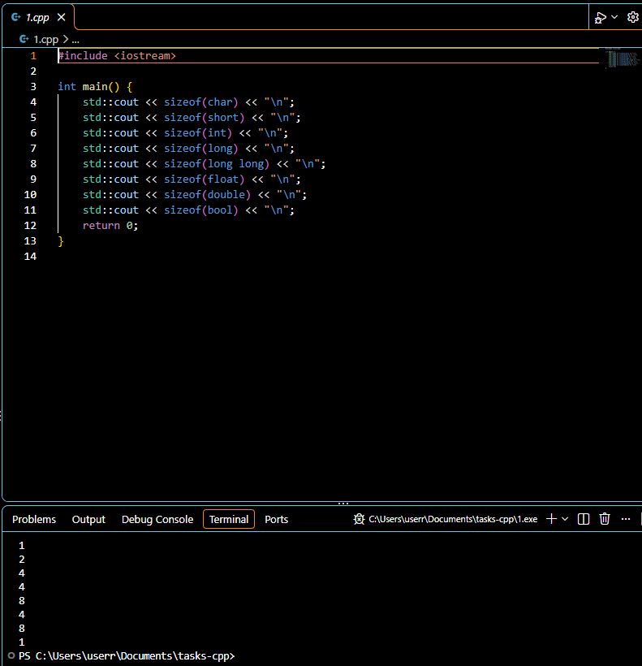
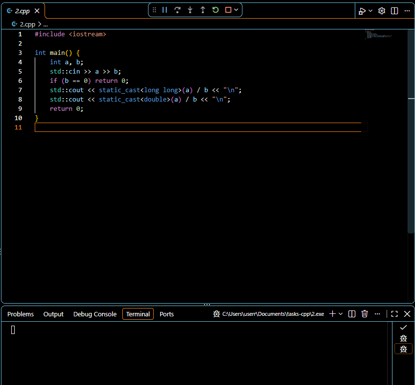
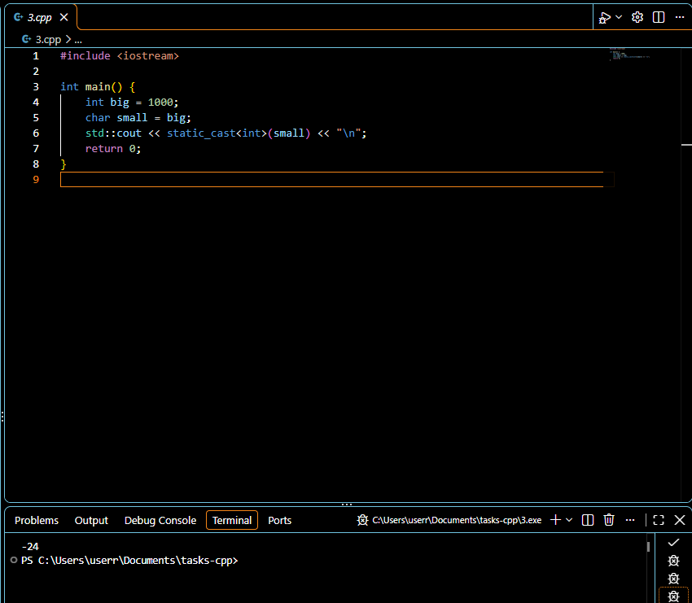
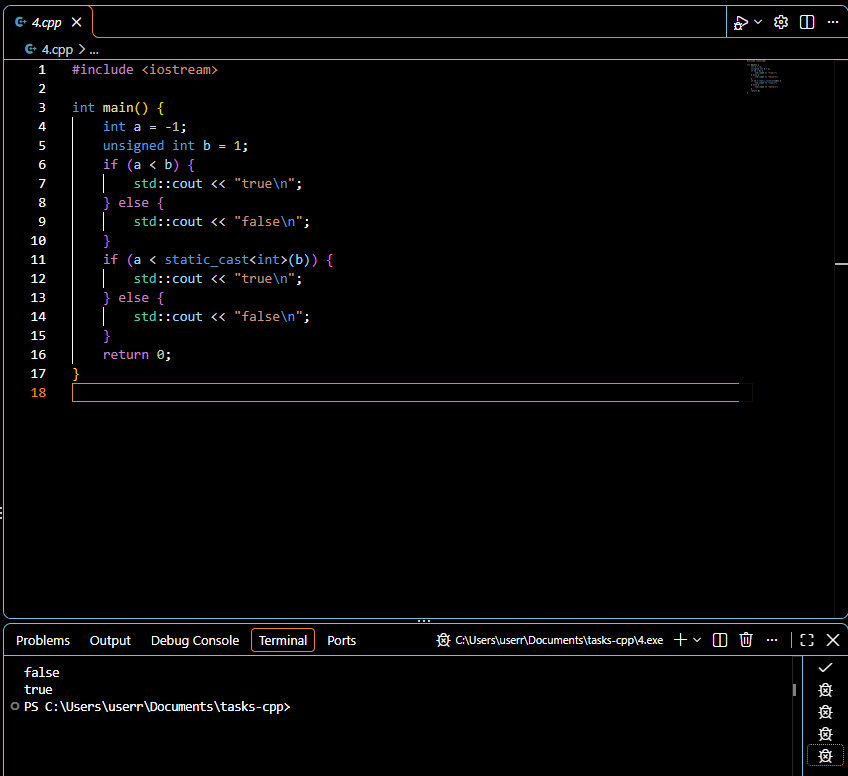
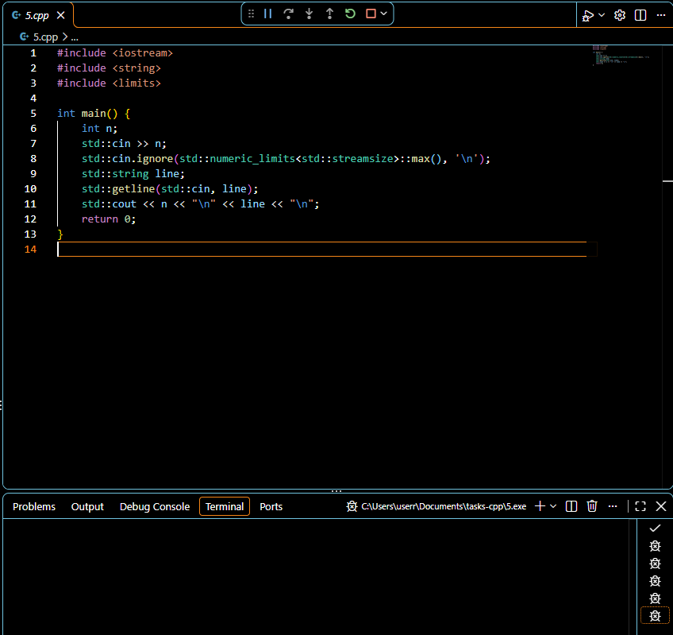
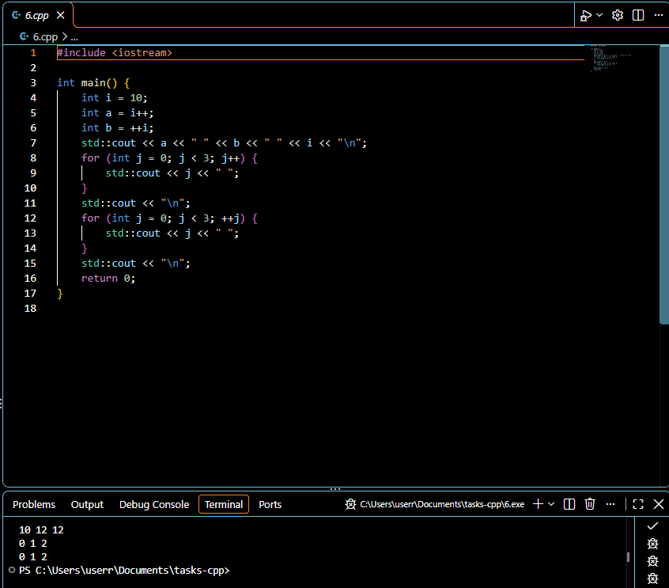
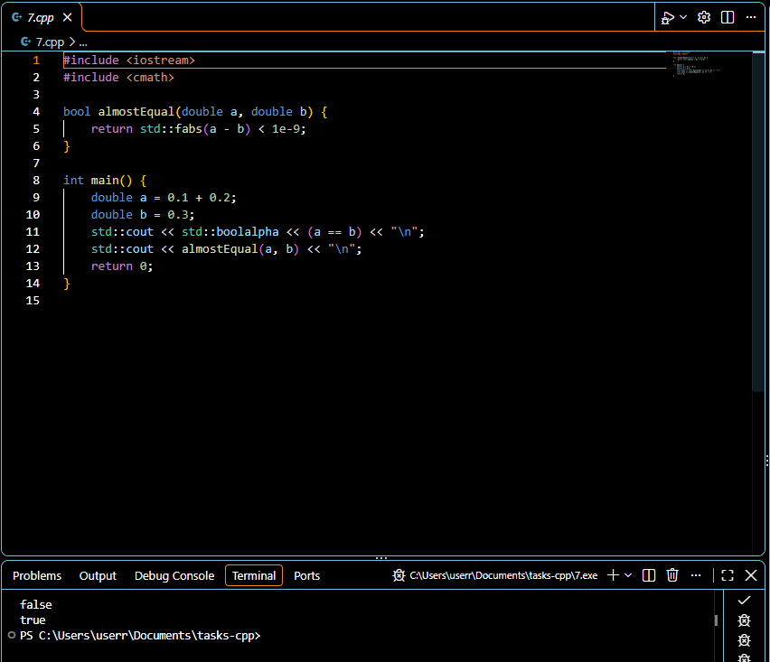
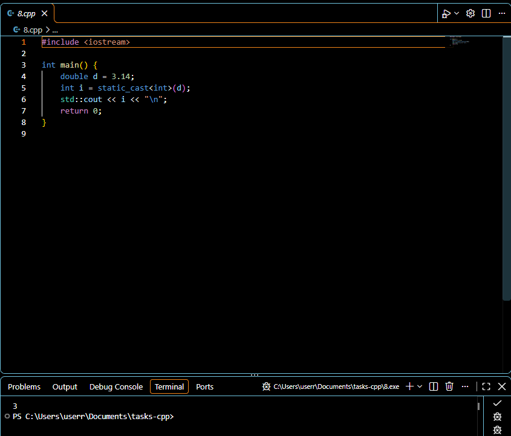

# Скриншоты заданий

[К описанию проекта](../README.md) · [К исходникам](../cpp_files/)

Код и состояние программ в VS Code. На скриншотах заданий 2 и 5 программы ожидают ввод с клавиатуры.

## 1. Размеры типов

[Код: 1.cpp](../cpp_files/1.cpp)

Вывод размеров типов на компьютере, где запускалась программа.

## 2. Деление чисел

[Код: 2.cpp](../cpp_files/2.cpp)

Программа запущена и ожидает два целых числа.

## 3. Преобразование int в char

[Код: 3.cpp](../cpp_files/3.cpp)

После преобразования `1000` в `char` на этой платформе получается `-24`.

## 4. Знаковое и беззнаковое сравнение

[Код: 4.cpp](../cpp_files/4.cpp)

Первое сравнение даёт `false`, после преобразования `b` в `int` получается `true`.

## 5. Ввод числа и строки

[Код: 5.cpp](../cpp_files/5.cpp)

Программа ожидает ввод. Перед `getline` остаток строки после числа удаляется через `ignore`.

## 6. Две формы инкремента

[Код: 6.cpp](../cpp_files/6.cpp)

Значения переменных: `10 12 12`. Оба цикла выводят `0 1 2`.

## 7. Сравнение дробных чисел

[Код: 7.cpp](../cpp_files/7.cpp)

Точное сравнение даёт `false`, сравнение с допуском `1e-9` даёт `true`.

## 8. Явное преобразование типа

[Код: 8.cpp](../cpp_files/8.cpp)

При преобразовании `3.14` в `int` дробная часть отбрасывается. Результат: `3`.

